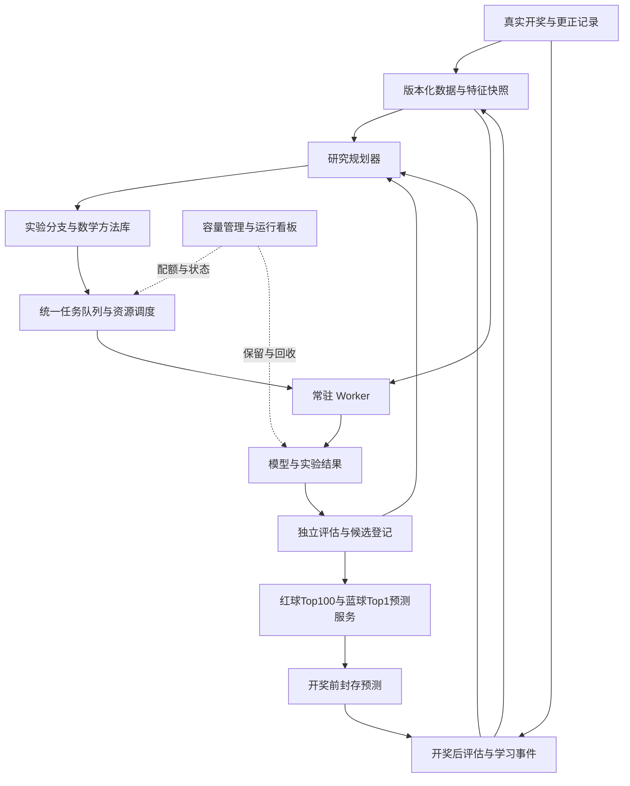

# DEHPS Next 完整重构方案 v1.1

更新日期：2026-10-24，Asia/Shanghai；现场抽查日期：2026-10-23  
性质：待实施的架构与验收方案。本文不表示系统已经实现、部署或取得预测优势。  
依据：网页对话《评估库并重构DEHPS》、宿主机只读抽查、2026-10-24新增需求，以及本文末尾的官方技术资料。

本版在v1.0基础上加入自动分支探索与回退、独立评价协议、数学研究与神经网络自训练、红蓝球联合范围，以及蓝球Top1命中率至少50%的业务目标。v1.0保留作为上一版记录。本版仅更新方案，不修改旧服务、不执行训练、不删除数据。用户消息中的“篮球”按双色球语境解释为“蓝球”。

## 1. 核心决策

DEHPS Next 建成一个能够长期运行的自主实验与逐期学习系统。它持续选择值得执行的实验、训练候选模型、检验结果、吸收新开奖并调整后续研究方向；每个任务有资源预算和结束条件，平台能够持续接续工作。

本次重构的五个核心交付是：

1. **学习闭环真实发生**：能够追踪“新数据 → 数据集版本 → 实际训练消费 → 模型产物 → 独立评估 → 后续任务”，而不只生成诊断报告。
2. **算力产生有效进展**：按真实吞吐量调节并发、线程和研究预算，降低重复计算、等待和过度并发。
3. **存储增长受控**：每类数据有用途、上限、保留周期和回收条件；海量逐步轨迹不再默认永久保存。
4. **研究方向能够演进**：智能体用数学工具提出、检验和修正新假设，实验树自动扩展、回退、剪枝与换方向，神经网络和方向价值模型实际训练。
5. **红蓝球目标清楚**：红球Top100、蓝球每期Top1；蓝球50%作为最低业务目标，是否达标必须由指定证据确认，不能由文字承诺替代。

首版采用新仓库 `dehps-next`、单台 Ubuntu 主机、单个 PostgreSQL 权威库、常驻 Worker、本地产物目录。取消从库要求；控制服务和数据库可先在本机，也可在部署时放到云端。Worker 始终从固定快照计算，不把远程数据库查询放进训练内循环。

预测模型以统计模型、线性模型、树模型及10万—100万参数神经网络为起点。100万—1000万参数属于通过性能测试后才开放的实验范围。神经网络训练和具备假设生成、工具调用、反馈修正能力的研究智能体都是完整首版的必要交付，不能用固定脚本轮询或只生成文字报告替代。GPU与多机仍为后续扩展。

训练范围确定为红球和蓝球：红球沿用Top100合法六红组合；蓝球对1—16输出概率分布，但每期正式预测只选择Top1一个号码。蓝球Top1的业务最低目标为命中率≥50%，定义和证据门槛见第5.6节。该目标由用户提出，尚无证据证明可以达到；达不到就记录未达标，不能降低口径或把工程验收通过写成预测能力达标。

现有数据、数据库、服务和报告链保持原状。本方案不执行删除、停机、迁移或生产切换，也不自动继承旧项目对写操作的授权。

“可以长期自主运行”是工程目标；“持续训练必然变强”不是可承诺的结果。如果数据中没有可利用的预测信号，系统应准确报告没有发现优势，并把预算转向有明确问题的实验或等待新数据。

## 2. 现场事实与问题定位

### 2.1 已确认的事实

2026-10-23 的检查以目录元数据为主，只抽取少量文件片段、执行摘要和数据库容量统计，没有读取完整大文件或全表扫描。

| 检查项 | 现场结果 | 对重构的含义 |
|---|---|---|
| 宿主机 | ThinkPad E16 Gen 2，Core Ultra 7 155H，16核22逻辑处理器 | 按混合核心 CPU 实测并发，不能把22线程视为22个等效核心 |
| 内存和系统 | 约32GB物理内存，系统显示30GiB；Ubuntu 26.04.1 | 小模型、共享快照和分块计算优先 |
| 系统盘 | 总容量约937GiB，已用约385GiB | “400G”接近整盘使用量，不是已确认的训练集大小 |
| 项目目录 | 约183GiB，其中 runtime 约181GiB | 大头来自运行产物 |
| 单个旧实验任务 | `m4-p2-false-positive-and-power-runs` 约160GiB | 一个历史统计验证任务占据项目绝大部分空间 |
| 该任务某次执行的恢复记录 | settled-fold-resume 约116GiB | 保存了大量逐期概率、目标和状态摘要 |
| 同次执行的检查点日志 | checkpoint-journals 约40GiB | 大量逐期摘要用于恢复和校验 |
| 执行摘要 | 31,000次重复实验、约6,466万次逐期评估；状态 COMPLETE；production_checkpoint_created=false | 实验完成记录不等于产生生产模型或提升预测能力 |
| 旧分发包和打包目录 | 约19GiB，含数据库导出及运行快照 | 迁移时按用途挑选，避免整包复制 |
| 当前 DEHPS 数据库 | 约25GiB，最大训练派生表约15GiB | 数据库也需要派生数据生命周期 |
| 11:00历史学习触发 | learning、observer 返回 AUTHORIZATION_REQUIRED；publisher 返回 training_executed=false | 这些触发当时没有训练，不能用服务成功退出代表学习成功 |
| 性能监控状态 | PASSIVE_WAIT_FORWARD | 等待新数据与正在训练应明确区分 |

以上目录大小存在包含关系，不能逐行相加；数据库也不能未经挂载核对就与项目目录当成完全独立的整盘占用相加。检查没有完成整个系统盘的归属审计，也没有证明所有训练路径都已停止。

### 2.2 目前能够支持的结论

旧系统至少存在三个需要重构解决的现象：历史实验轨迹保存得很重；“服务运行、定时触发、实验完成、模型学习”容易混在同一类进度中；部分自动学习触发被授权状态阻断。

这些文件并非毫无用途：它们承担旧实验恢复、完整复核和来源证明。仅凭抽样不能宣布旧系统已无消费者，也不能保证凭种子就能逐位重建全部结果。新版可以不迁入这些轨迹，但旧系统清理应作为独立退役操作。

本次检查没有完成预测效果审计。因此不把“占用很大”推断成算法一定无效，也不把旧实验的 COMPLETE 推断成预测优势。

## 3. 首版范围与系统结构

### 3.1 逻辑结构



### 3.2 最小部署单元

| 单元 | 职责 | 首版约束 |
|---|---|---|
| 控制服务 | 数据版本、智能体研究规划、实验分支、队列、节点、结果接收、状态接口 | 一个部署包，模块内分层，不拆一组微服务 |
| PostgreSQL | 权威状态、元数据、任务租约、预测和结果索引 | 一个权威库，按用途分 schema 即可 |
| Worker | 特征、训练、回测、组合选择、恢复 | 一套协议，按任务类型调用插件 |
| 研究智能体 | 读取允许的研究经验，提出假设、选择数学工具、生成实验定义、分析失败并调整方向 | 推理后端可配置；没有实际推理与决策证据不能算完整交付 |
| 独立评估模块 | 管理验证清单、可用时点、对照、评分和证据标签 | 接口与权限独立于候选模型；首版不必另建微服务 |
| 本地产物存储 | 数据快照、模型、必要明细 | 内容校验、原子发布、配额管理 |
| 运行看板与通知 | 当前工作、学习证据、性能、容量、阻塞原因、报告状态 | 先完成必要操作和证据展示 |

常驻循环通过新数据、任务完成、节点变化等事件驱动，并做周期性对账。系统服务负责进程存活，不能替代任务调度。通知只用于加速唤醒，持久任务状态始终以数据库为准。

首版不引入 Kubernetes、跨机器同步训练、第二套消息队列和完整自研参数优化器。新增机器优先并行执行独立实验，任务协议预留节点能力、租约和结果上传。

### 3.3 技术选型

| 部分 | 建议 |
|---|---|
| 研究与训练 | Python、NumPy、scikit-learn；神经网络使用 PyTorch |
| 参数搜索 | Optuna，通过适配器接入统一调度 |
| 研究推理与经验 | 可配置推理模型、受控工具调用、数学方法库、版本化经验库，以及可训练的方向价值估计器 |
| 控制接口 | Python API 服务，建议 FastAPI，与训练共享契约 |
| 状态和任务 | PostgreSQL，事务、唯一约束、租约与原子领取 |
| 文件 | 原始小数据与配置用结构化文本；批量数值明细用 Parquet 或数组格式；模型使用框架支持的安全加载方式 |
| 界面 | 薄 Web 看板；具体前端框架在实施启动时确定，不影响内核设计 |
| 运维 | Ubuntu 服务管理、固定依赖环境、独立应用目录和数据目录 |
| 加速 | 先向量化与批处理，再按热点决定 Numba/C++；GPU单独测收益 |

版本在实施时按依赖兼容性锁定，不沿用旧环境对某个 Python 版本的硬绑定。开发、测试和生产使用同一份依赖锁定与运行镜像身份。

## 4. 真正持续自主学习的设计

### 4.1 四个持续循环

| 循环 | 没有新开奖时 | 有新开奖时 | 必须留下的证据 |
|---|---|---|---|
| 数据循环 | 检查来源、完整性和可用时间 | 登记开奖，处理冲突，发布新版本 | issue_id、来源、available_at、版本和校验 |
| 模型循环 | 训练、继续训练、早停、定期从头重训 | 消费新样本，训练挑战模型 | 输入版本、父模型、消费范围、训练步数、输出模型 |
| 实验循环 | 比较参数、特征、窗口、模型和组合策略 | 把新结果加入诊断，安排下一实验 | 实验问题、对照、预算、结果、后续动作 |
| 预测与反馈循环 | 生产模型按时生成并封存下一期预测 | 先评估已封存预测，再产生学习事件 | 封存时间、真实结果、误差、消费与后续模型记录 |

同一批历史数据训练更多遍属于优化过程，不增加独立开奖样本量。生成模拟数据属于检验或训练辅助，必须单独标识，不能计入真实逐期预测成绩。

### 4.2 每期学习顺序

1. 开奖前，用已接受的模型、当时可用的数据版本和固定组合策略封存预测。
2. 开奖后校验真实结果；与已有来源冲突时标为 DATA_CONFLICT，禁止静默覆盖。
3. 评估开奖前已存在的预测，记录全部成功与失败；缺失预测保留为缺失，不补造。
4. 生成唯一学习事件，发布新的数据集版本。
5. 规划器安排增量学习、必要的从头重训和诊断实验。
6. Worker 记录实际加载、用于梯度或拟合的数据范围，以及排除的样本。
7. 新模型先完成研究验证和影子预测，按固定准入政策决定是否进入正式预测。
8. 记录下一项任务，形成可继续推进的依赖链。

过去某期结果一旦用于训练，就不能再用该模型在同一期上的表现冒充开奖前成绩。模型变化也可能来自历史参数优化，只有实际消费新真实样本时才登记为相应的数据学习事件完成。

### 4.3 学习事件的可核验定义

每个事件至少关联：

`真实期次 → dataset_version → training_job → attempt → parent_model → output_model → evaluation → next_action`

训练事件记录样本标识或范围摘要、重复次数、采样权重、样本数量、训练轮数、代码与配置身份；评估事件记录没有参与该候选拟合或选择的评估边界。

“训练完成”与“学习产生改善”分开表示。以下状态都应被允许：已消费但未改善、挑战失败、证据不足、改善待前向确认、无可晋升候选。

如果输出模型没有产生预期更新，系统报告未变化及原因，例如无新样本、训练步数为零、提前失败或优化未更新参数，不能只凭输出了文件就算学习。

### 4.4 研究规划器如何选择下一项实验

完整首版由研究智能体提出可执行假设，搜索算法调参，神经网络学习数据规律，独立评估模块提供反馈。规则负责预算和契约，不固定所有研究方向。推理后端可用本地模型或已配置的外部服务，部署时测量能力与成本；不能默认155H能高效训练或运行大型推理模型。

推理服务暂不可用时，已有有效实验和数据学习仍可执行；新假设规划显示明确降级状态。若只有预设网格或固定规则循环，则只能验收执行内核，不能宣称已交付用户要求的自主研究AI。

每个研究问题包含：目标、时间边界、候选范围、对照、主指标、预算、失败条件、停止条件和结果使用方式。优先级综合考虑新数据覆盖缺口、已有结果的不确定性、候选多样性、估计成本及最近失败。

建立三类有限队列：新候选探索、候选复核、诊断与基准维护。初始研究算力权重可设为60%探索、25%复核、10%诊断、5%维护，作为可调整起点；正式预测与开奖后结算按截止时间优先处理，空闲配额可借用。

搜索使用低成本筛选、较完整历史验证、固定协议复核三级预算。淘汰明显较差候选；有希望的候选获得更多资源。每一级只使用其被允许看到的数据。

实验身份由数据版本、特征版本、模型定义、参数、窗口、随机种子、代码、评估协议及数值环境组成。相同身份的已完成实验复用结果；增加种子做稳定性验证应登记为明确重复实验，不能伪装成新研究方向。

队列深度、每日新增候选数、研究主题数量及单主题总预算都有上限，防止规划器自身无限生成待办。预算耗尽或结果长期无进展时降低该主题优先级，记录停止理由和后续重启条件。

### 4.5 增量训练与从头重训并存

支持增量更新的模型在新数据到来后按协议更新；不支持的模型通过训练任务重训。神经网络保留有上限的历史回放，避免只围绕最近一期更新。

定期比较“从旧权重继续”和“相同数据从头训练”，避免长期沿用一个退化模型。频率和窗口由实验确定，不能把“每期必须改变模型”设为成功标准。

误差诊断可以提出遗漏、共现、时间窗口等特征假设，但诊断标签只进入后续可用时点。对失败样本的额外采样必须登记并受限，避免无限强化最近一次失误。

### 4.6 没有新数据时的行为

仍可执行预先定义的特征消融、稳健性、超参数、组合覆盖、校准、实现性能比较和随机对照实验。已有问题的边际收益下降时，转向下一个不同问题。

当授权范围内的有效研究空间耗尽，状态为 SEARCH_EXHAUSTED 或 WAITING_FOR_DATA，并给出已完成范围和重启条件。系统保持常驻，等待事件；不能通过更换名称重复相同计算来维持高负载。

SEARCH_EXHAUSTED首先表示当前研究主题的预算或有效候选耗尽。研究智能体应尝试从允许的其他数学方法、表示、模型族和问题定义中提出不同方向，评估可执行性后开启新根节点。只有所有允许方向均无有效下一步、资源不足或推理不可用时，才进入全局等待。

长期自主运行必须具备不断接纳新数据、新研究定义和新插件的能力；有限数据与有限研究空间不能保证无限产生新知识。

### 4.7 自动分支探索、失败回退与剪枝

研究结构采用持久化实验树；共享同一数据、特征或模型时通过引用形成有向无环依赖，避免复制。根节点表示一个已登记的研究起点，不一定是正式生产模型；每个子节点描述相对父节点改变了什么。

用户示例对应如下流程：

```text
1：父模型、数据范围、评估协议与恢复锚点已经登记
├─ 1-1：尝试频域特征
│  ├─ 近期窗口 + 预定随机历史起点验证
│  └─ 按协议确认退步 → 剪枝，恢复节点1的研究状态
├─ 1-2：改用另一训练窗口或正则化方向
│  ├─ 同一清单比较 → 有希望但证据不足 → 追加有限预算
│  └─ 确认改进 → 继续1-2-1、1-2-2等子方向
└─ 1-3：尝试不同模型族
   └─ 输入或结构不兼容 → 从同一合法数据边界重训
```

回退恢复父节点的训练配方、兼容模型检查点、优化器、随机状态和数据游标，不恢复已经消耗的算力、不抹去失败记录、不让已看过的验证集重新变成未见数据。父节点若使用了较晚期数据，其权重不能直接用于更早历史期次的因果验证；必须重建当时可用的训练状态。

节点记录至少包含：node_id、parent_id、研究问题、可证伪假设、数学方法与适用条件、变更差异、数据/特征/模型身份、可继承的检查点、验证清单、种子、预算、评价摘要、剪枝/回退原因和下一动作。节点状态与执行尝试分离：尝试崩溃可重试，研究结论不因此消失。

评价后的动作分为：继续扩展、证据不足需复核、确认退步后剪枝、无效或泄漏后隔离、预算耗尽暂存。并非只要某个分数小幅下降就剪枝，更不能凭单期没中决定方向失败。节点1-1相对节点1的配对差异、主指标、退步容忍度和不确定性规则在开跑前固定。

已有明确失败的同身份分支不再反复生成；新数据、不同假设或修复后的实现可以触发有原因的重开。研究智能体保留失败原因，用于提出1-2，而不是仅将实验编号加一。

首版采用预算约束的最佳优先与保留多样性的分支选择：优先扩展预计收益和不确定性较高、成本合理的候选，同时为不同方法族预留探索份额。可逐步训练节点价值估计器，学习“在什么条件下哪种方向值得继续”。不宣称使用回溯就能保证找到全局最优。

每个研究主题初始最多4个活跃训练叶节点，保存少量可恢复锚点和优胜节点；数量随资源配置。祖先可保留配方和重建所需输入，不要求每层永久固定全量模型。失去完整检查点的节点明确标为需重训。失败节点只保留有界摘要，GC按依赖保护活跃回退路径，防止实验树重现旧系统的数据膨胀。

### 4.8 能提出新问题、修正判断的研究智能体

自主研究能力的可执行定义为：读取允许的历史经验 → 识别未解释现象 → 提出至少两个不同且可证伪的解释 → 选择数学工具和实验 → 根据实际评价修正判断 → 决定继续、回退或更换方向。这里定义的是可观察的推理与学习行为，不以模型自称“我在思考”作为证据。

智能体可在既定工具、数据和预算范围内自动组合特征、选择模型族、生成研究定义，并在隔离环境内生成或修改候选实现。候选实现须经过契约、数值、泄漏与资源检查后才能执行；不修改独立评分器、最终验证清单或正式模型目录。工具范围内的实验不逐次找人审批。

保留简洁的研究决策记录：假设、所用证据、选择理由、可证伪预测、实际结果和下一动作，不要求保存推理模型的隐藏思维过程。会说理由却没有工具结果、真实训练或方向调整，不算自主研究完成。

区分三种学习，分别验收：

1. **预测网络训练**：真实开奖进入红蓝球网络，记录梯度/拟合更新和父子模型。
2. **研究策略学习**：用已允许的实验反馈训练方向价值估计器，或按版本更新可学习的搜索策略；最终隔离验证标签不能成为其训练奖励。
3. **数学知识运用**：将可靠资料变成可执行方法、前提、数值检查、应用实验与成败经验。方法库和经验记忆更新不等于推理模型权重已经微调；若以后训练推理模型权重，另记数据、训练与保留能力评估。

不要求一开始就从零训练一个通用数学大模型。先使用有能力的推理后端及数学工具，让预测网络和研究价值模型承担本项目可负担的实际自训练；对推理后端的端点、费用、离线能力和许可在部署前明确登记。

### 4.9 数学方法库与逐步学习课程

数学方法必须被转换成可验证的程序和实验，不能仅给分支冠以数学家姓名。

| 方法来源 | 可执行研究方向 | 必须检查的前提与失败方式 |
|---|---|---|
| 傅里叶变换、傅里叶级数 | 号码逐期指示序列的局部频谱、过去窗口内拟合的正弦余弦基、候选周期的时外稳定性 | 频谱峰不等于可预测周期；频率选择与系数只能在训练窗拟合，防止全历史变换泄漏 |
| 牛顿与二阶优化思想 | 小模型的阻尼牛顿、拟牛顿、曲率近似、校准参数优化 | 检查收敛、病态和正则化；不对百万参数默认构造稠密Hessian，不把优化更快当预测更准 |
| 高斯相关统计与最小二乘思想 | 正则化最小二乘基线、残差、协方差、误差传播和不确定性分析 | 开奖号码不因引用高斯而服从高斯分布；分类概率和依赖结构须单独检验 |
| 黎曼几何与现代信息几何 | 概率分布几何、约束参数化、自然梯度或低成本近似 | 明确采用的度量和优化问题；自然梯度是现代方法，不把它直接归为黎曼本人的算法 |
| 概率、信息论与组合数学 | 合法样本空间、概率校准、条件熵、特征依赖、组合覆盖与随机对照 | 区分相关和可预测增益，模拟样本不增加真实开奖样本量 |

号码是类别。频域研究优先对每个号码的出现指示序列或其他有明确定义的统计量建模，不能直接把任意号码编码的起伏解释为物理波形。跨红蓝关系的特征也只能用过去已开奖信息，不能用待预测当期的真实红球预测同一期蓝球。

每个方法按“理解定义与适用前提 → 解析例题/已知信号测试 → 无信号负对照 → 小预算真实历史实验 → 多窗口复核 → 未见期次证据”的课程推进。傅里叶分支需先能恢复已知合成频率并在纯噪声上控制假发现；优化方法需验证梯度、数值稳定性和基准目标；这些练习证明实现能力，不证明彩票预测有效。

方法使用记录形成版本化知识卡：原始来源、公式与假设、实现版本、数值检查、适用数据、实验结果、失败边界和下一种可检验组合。智能体可以从“傅里叶分支不稳”转向“局部窗口+正则化”或其他方法族，而非永久重复同一技巧。

FFT的具体变换由数值库执行；二阶优化和最小二乘可复用成熟实现。[NumPy FFT](https://numpy.org/doc/stable/reference/routines.fft.html)、[SciPy优化](https://docs.scipy.org/doc/scipy/reference/generated/scipy.optimize.minimize.html)、[SciPy最小二乘](https://docs.scipy.org/doc/scipy/reference/generated/scipy.optimize.least_squares.html)。信息几何方向可参考其实际研究文献，不外推为双色球有效性证明。[自然梯度与黎曼参数空间研究](https://journals.aps.org/prl/abstract/10.1103/PhysRevLett.81.5461)

## 5. 评价体系：避免越搜越“优秀”的假象

### 5.1 时间边界与验证纪律

探索历史、候选选择历史、冻结评估和真实前向记录分开管理。历史回测采用按时间推进的训练/验证方式，预处理、标准化、特征选择和校准也只使用当时的训练部分。

候选可以反复搜索探索区，不能无限查看同一冻结区后继续把它称为独立验证。一旦某段评估用于调整模型，它便进入已使用历史；后续独立证据来自新的未见期次或新冻结协议。

近期窗口验证与随机历史抽样都必须纳入分支比较；随机抽取的是合法的历史预测起点或连续区段，而不是随机打乱所有期次后混合训练和测试。对目标期t，模型、统计、傅里叶系数、归一化、校准、特征选择及训练样本都只使用t之前已可用的信息。官方时间序列验证工具也特别指出普通交叉验证可能导致用未来训练、向过去评价。[TimeSeriesSplit说明](https://scikit-learn.org/stable/modules/generated/sklearn.model_selection.TimeSeriesSplit.html)

历史时点回放只保证该次运行遵守数据可用时点；若模型配方本身已经根据这段历史反复设计，它仍属于回顾性研究，不能恢复成真正未见的独立证据。

真实前向预测一经开奖，该期可在后续成为训练数据，但保留当期预测原件和当时模型身份。重新计算的历史预测必须标记为回放。

### 5.2 指标分层

| 层次 | 主指标或记录 | 解释 |
|---|---|---|
| 概率模型 | 预先固定的概率损失、Brier 分数、校准误差 | 衡量概率质量；33个球的边际概率不自动构成合法联合组合概率 |
| 蓝球模型 | 16类交叉熵、Brier、校准、严格Top1命中率 | 只允许一个正式号码；红球候选数量不能扩大蓝球命中定义 |
| 组合选择 | 固定Top100预算下的红球匹配分布、红4及以上覆盖、组合重叠与多样性 | 与同预算对照比较，并记录所有期次 |
| 稳定性 | 不同时间窗口、随机种子、训练起点的变化 | 防止依赖单次幸运结果 |
| 运行 | 样本消费、有效实验、吞吐、失败、等待、容量 | 证明系统确实执行了工作 |

输出必须满足合法球号、每注六个不重复红球、组合去重等规则。正式输出为Top100红球组合加当期唯一蓝球Top1，默认100个红球候选共用这个蓝球；不允许用不同蓝球覆盖16种结果却报告Top1。红蓝分别评价；红蓝都命中、完整奖级或收益如以后统计，必须另设准确口径，不能把蓝球50%当成整注中奖率或盈利率。

保留均匀随机、简单历史统计和旧模型可复现基线；组合策略另设具有相近覆盖或重叠约束的对照，减少组合集中度对比较的干扰。对照提前固定，不在看到本期结果后挑选。

相同100注预算下，以“期”为主要统计单位，不能把100注或模拟重复次数当成100个新的独立开奖。置信区间与检验方法在协议中预定，涉及时序相关时使用相应的区块或稳健处理。

研究搜索记录尝试次数、主指标和终止条件。不能只公布最大成绩；多重比较与反复查看的影响需在候选评价中处理，最终的真实前向结果不因历史搜索次数而变成更多证据。

### 5.3 模型登记和替换

区分研究候选、影子候选、正式模型和已退役模型。新候选首先过数据完整性、合法输出、同协议基线比较和资源检查，再进入影子运行。

正式模型替换依据预先接受的规则或明确的人工发布操作，不能由当前候选自行改变规则。证据不足时继续使用原模型或已定义的简单基线。

模型替换采用指针切换，保留前一正式版本、输入契约和回退包。模型质量结论与平台工程验收分开；首版完成不以“必须预测获胜”作为验收前提。

需要区分两种更新：**已接受训练配方的新数据重训**，在样本、数值、输出、资源和回退检查通过后，可按已接受政策自动发布新权重，用于下一期；**模型结构、特征、组合策略或评价规则改变**，则走候选验证流程。日常数据学习不必每期重新等待一轮长期影子验证，也不要求人逐次审批。

同配方自动更新是运行政策，不是预测改善证明。所有发布后的模型继续累积真实前向成绩；健康检查或反复使用历史验证集通过，都不能标成新增独立效果证据。生产规则变更前，正式模型继续按原配方学习。

### 5.4 近期、随机历史、隔离验证与真实前向的分工

| 层次 | 默认设计起点 | 用途与限制 |
|---|---|---|
| 近期历史 | 最近60个合法历史预测起点，按时间推进 | 发现近期退步与适应性问题，属于可反馈的开发验证 |
| 随机历史 | 在符合最小训练长度的历史区间预定抽样，默认200个不同目标期；可先随机选连续区段再取其中起点 | 检查跨时间稳定性；按时间分层，不按开奖结果或命中情况挑选 |
| 隔离复核 | 独立模块保管的未参与该轮搜索的数据及协议 | 只给少量冻结候选，限制查询次数；被反复使用后取消独立标签 |
| 真实前向 | 在开奖前登记并封存，开奖后评价 | 用于最终能力声明；所有指定期次留存，不补选最好的一段 |

60和200是拟定的开发验证规模，可在实验开始前按数据量及资源统一调整；不足时报告实际有效期次。近期与随机集合若重叠，分项分别报告，但汇总时按期次去重，不能把同一期当成两个独立样本。

同一轮的父子节点使用同一验证清单、分层方式和随机种子，给出配对差异。每次抽新清单必须记录原因和版本，不能因为分数不好就重抽。复核可使用预定的另一套清单；不因“随机抽样”四字自动获得独立性。

新增分支先通过低成本检查，再执行近期与随机历史验证。明显退步且证据充分则回退；结果冲突或样本不足时保留为不确定，执行预定有限复核。最终隔离数据不对每一个分支开放，以免智能体不断通过评分反推出答案。

### 5.5 “权威验证”的可检查含义

不承诺任何有限样本验证可以绝对证明未来表现。这里的权威指来源、边界、算法和结论都能被独立核查。

1. **数据真实**：使用官方开奖与可追溯来源，保存原始期次、获取时间、更正及冲突；冲突未解决不下结论。
2. **协议先定**：先登记输入范围、抽样规则、种子、主次指标、最小预算、剪枝阈值和统计方法，再运行候选。
3. **严格时间边界**：防止未来样本、当期真实红球、全历史FFT和事后挑窗口进入训练。
4. **评价职责独立**：研究智能体提交候选，评分器只执行已冻结契约；候选不能改评分器或改自己的验收口径。自动评估不等于人工审批。
5. **比较公平**：同目标期、同输入可用边界、同红球候选预算及蓝球Top1约束比较；增量继承与从头训练的总计算成本分别记录。
6. **证据完整**：保留样本清单、预测、实际结果、置信区间、失败分支、尝试次数及模型版本；被剪枝的失败不能从整体研究记录中消失。
7. **控制反复搜索**：多分支探索只产生开发证据；正式能力声明使用另行固定且受保护的评价，不能靠挑分支、挑起止期或反复查看刷过关。

严格复核由固定版本的实现重算必要样本并比较；不要求把每一步恢复轨迹永久写盘。独立性来自权限、契约与未使用数据，不来自一个模块被命名为“Reviewer”。

### 5.6 蓝球Top1至少50%的目标与达标口径

官方规则中蓝球号码为1—16。[双色球游戏规则](https://www.scflcp.com.cn/yxgz/823145252.jhtml)。在均匀且独立的假设下，每期只选一个号码的随机命中率为1/16=6.25%；50%相当于该基线的8倍。若开奖对于历史信息确实均匀独立，仅凭更多训练不能把条件命中率提升到50%。当前没有证据证明存在足以达到该目标的可用信号。

用户提出的50%保留为最低业务门槛，不改成“比随机好一点”。必须同时区分“观测命中率达到50%”和“证据支持稳定达到50%”。

严格口径：每个指定评价期，在截止时间前封存一个1—16号码；Top1并列时按预定规则唯一选出。命中次数H除以全部指定有效开奖期数N。遗漏、预测过晚或没有有效封存预测的期次在业务统计中按未命中计入，并另报覆盖率。只有官方未开奖、取消或结果冲突等按事先规则排除，不能因难预测而跳过。不得以TopK、候选组并集、模型自报置信度或开奖后修订代替Top1命中。

所有研究分支同时报告开发历史命中率；该指标只用于探索，不能单独宣布满足最终业务门槛。正式评价对象可以是一个固定模型，也可以是预先冻结的自动更新/分支选择政策；后者允许系统继续学习，但每期选择必须在开奖前发生。事后逐期挑命中模型的组合不属于合法政策成绩。

首版建议固定一个100期连续真实前向评价批次作为正式判定起点，起始点、样本数和政策先登记；旧历史回放可以立即验证工程与研究能力，不能代替等待真实未见结果。100期是拟定证据规模，不是“完成100期就一定达标”的承诺，其观察时间也独立于首版工程开发期限。发布前可依据功效与精度分析修改样本量，但不能根据已经看到的成绩缩短或延长来凑结果。

判定分层：

- **目标未达**：指定期次观测Top1命中率小于50%。
- **观测达到、稳定性待证**：观测值至少50%，但独立性、样本量或不确定性证据不足。
- **证据支持达标**：观测值至少50%，按预登记方法计算的95%区间下限也至少50%，数据和预测封存完整，且没有搜索污染。

在固定样本、近似独立且命中概率可按稳定二项模型处理时，可报告Wilson区间；若存在时序依赖或在线政策变化导致该假设不适用，则预先采用相应稳健方法或保持证据不足，不强行套用二项模型。[NIST比例区间说明](https://www.itl.nist.gov/div898/handbook/prc/section2/prc241.htm)

作为Wilson两侧95%区间的计算示例，100期中50期命中的点估计是50%，下限约40.38%；60期命中时下限约50.20%。示例只是说明点估计与证据门槛的差别，不能用来事后设置停机点。连续查看可作监控，正式判断在预定批次末进行；若需要随时判断，另行固定适合序贯评价的方法。

工程完成、研究能力完成与蓝球业务目标分别验收。即使系统自动探索和训练全部运行正确，若上述命中目标没有获得支持，产品状态仍写“蓝球50%目标未达/待证”，不能通过修改指标宣告成功。

### 5.7 红蓝球神经网络与联合实验

首版必须实际训练红球网络与16类蓝球网络。可从独立小网络做对照，再尝试共享时序编码器加红球、蓝球双输出头；是否共享由同协议实验决定，防止红球任务伤害蓝球或反之。

输入为截至上一期的红蓝类别指示、合法历史统计及已经验证的数学特征；窗口长度、正则化、损失权重和模型族通过实验树选择。蓝球用16类交叉熵等概率损失训练，并以严格Top1率和校准验证；网络给某号码50%概率不代表已经实现50%命中。

红球输出概率与合法组合生成分层，生成Top100六红组合；蓝球只选择一个正式号码。即使未来研究联合概率，也不能在开奖前输入当期真实红球。跨任务的主指标、退步约束和计算预算事先登记，不能用红球改善抵消蓝球最低目标未达。

若导入历史缺蓝球，先补全和校验来源。缺失或不完整期次不能伪造标签，也不能在声明全量红蓝训练时悄悄排除。

## 6. 算力利用与资源调度

### 6.1 先测量，再确定并发

每台节点注册时执行有时间上限的代表任务：小模型训练、传统模型拟合、特征计算、组合评分和结果写入。测量冷启动与热缓存、峰值内存、有效吞吐和持续负载下的温度/频率变化。

在当前155H上，以1、2、4个计算进程和1、2、4、8个内部线程构成受控候选组合，剔除明显过度订阅配置后比较。先做短筛选，再对优胜配置做持续负载测试。最终参数不能由“22逻辑处理器”直接推导。

节点预留操作系统和控制服务资源。当前主机还有其他应用，初始训练内存上限建议取“物理内存约60%”与“当前可用内存扣除系统保留量”中的较小值；专用训练主机在持续测试后可提高，但不默认超过物理内存约75%。均为起始配置，非已验证最佳值。

研究推理也纳入资源调度：本地推理模型的加载内存、线程和模型缓存与预测网络合并计算；外部推理服务设调用与费用预算。研究规划低频批量进行，避免对每个训练step调用推理模型。推理不可用或预算耗尽时已提交的合法训练继续，不能由重试调用挤占全部资源。

调度器同时限制进程数、每进程计算线程、数据加载线程、Arrow读线程和并发写入数。PyTorch 官方明确说明过度订阅会造成争抢，提供了按进程限制内部线程的方法。[PyTorch多进程实践](https://docs.pytorch.org/docs/2.14/notes/multiprocessing.html)

### 6.2 衡量有效吞吐

主要指标是每小时完成的可比较独立实验、固定评估工作量耗时、CPU时间、等待时间、重复命中率、峰值内存及写入字节。

相同基准工作量与数值标准下比较调优前后表现。不能用缩小验证范围、降低不允许的数值精度或跳过检查获得虚假的加速。

当持续有可运行任务时，让可分配计算资源得到较高利用；高I/O等待、反复重算和检查点刷盘不计为有效算力利用。没有有效任务时不设强制CPU占用目标。

### 6.3 任务优先级与让出资源

| 优先级 | 内容 | 调度行为 |
|---|---|---|
| 最高 | 有截止时间的正式预测、数据同步和结算 | 预留资源，必要时让研究任务在检查点处暂停 |
| 高 | 新数据学习、已入选候选复核 | 避免长期被低价值探索占满 |
| 普通 | 参数与特征探索 | 按预算和公平份额运行 |
| 低 | 大规模模拟、缓存预热、离线压缩 | 只使用剩余资源，且有独立配额 |

同一套代码执行这些任务，通过资源池和优先级隔离。只读状态检查不占用独占训练锁；正式预测完成后，研究任务自动恢复，不依赖人再次启动。

长任务切成可恢复批次，目标是在约60秒内对暂停请求作出响应；短于检查点成本的任务允许直接完成。恢复不重做已经提交成功的工作块。

### 6.4 降低重复计算和内存放大

固定数据与特征快照共享；同一版本只生成一次基础特征。训练进程尽量共享只读数组，避免每个进程完整拷贝。

组合评分按块执行，只保留必要TopK和汇总，不默认保存每轮全部组合分数。缓存键包含输入、代码和数值配置，变更后显式失效。

模型热路径优先批处理与向量化；热点经测量后再下沉到 Numba/C++。加速实现需验证合法组合、排序、概率与基准数值的一致性或既定容差。

### 6.5 功耗、GPU与多机

使用系统支持的性能模式和资源限额，不把修改硬件功耗寄存器作为首版依赖。持续降频时用吞吐与温度曲线解释瓶颈，再调整并发。

GPU作为独立后端验证驱动、算子、数值和实际耗时。小模型是否受益由端到端基准决定；CPU路径一直保留。

多机阶段先分配独立实验或不可重叠评估分片。节点报告可执行后端、内存与速度，慢节点领取较小任务。租约、数据快照和结果协议从首版预留，但不提前搭建复杂集群。

## 7. 控制面与自主权限：让普通学习无需逐轮审批

### 7.1 预先接受研究范围

部署时定义一份版本化运行政策：允许的模型与插件、可用数据、参数范围、资源和写入配额、网络范围、自动重试、运行时段和候选晋升规则。

政策范围内的取数、训练、评估、早停、恢复和结果登记自动进行，无需为每轮实验创建新的人工审批。超出政策的新增代码、未知插件、规则改变、生产发布或旧系统删除作为独立操作。

预先允许的数学方法组合、候选实现沙箱、分支回退与剪枝属于日常自主研究范围。方向改变本身不是审批理由；只有越出已接受的数据、工具、权限、预算或发布范围才触发人工决策。所有候选仍通过自动验证，不等于免除可复核要求。

政策是一种部署后生效的设计，不能在此次方案阶段声称已获所有生产操作授权，也不能伪造旧系统 Reviewer 记录。

政策具有明确状态和版本。需要续期时提前通知；权限阻塞显示缺少哪项能力、影响哪些任务、修复入口和是否可运行其他队列。不能以“等待中”掩盖原因。

### 7.2 统一状态机

任务主状态：待依赖、就绪、已领取、运行中、暂停、成功、淘汰、失败、取消、明确阻塞。阻塞原因另列：等待新数据、缺权限、内存不足、磁盘配额、来源冲突、搜索耗尽等。

系统同时展示“进程在线、任务执行、模型更新、预测有效性”四种事实。服务exit code为0只证明本次进程正常退出，不直接推进训练完成计数。

### 7.3 领取、重试与断线恢复

每次执行持有任务租约、attempt_id和递增令牌。初始心跳15秒、租约120秒，可按任务类型调节。原子领取可采用 PostgreSQL `FOR UPDATE SKIP LOCKED`；它适合队列消费者避免互相等待，不能代替租约与业务幂等。[PostgreSQL SELECT文档](https://www.postgresql.org/docs/current/sql-select.html)

任务可能被重试执行，但有效结果只能提交一次。结果提交时校验当前令牌、任务输入、文件校验和与状态；过期执行不能覆盖后来完成的结果。

节点短时失联可在当前租约内工作；失联超过租约后仅允许有预算的本地暂存，停止领取新任务。恢复后重新核验归属，过期结果只能登记为待核查或丢弃的尝试，不能自行成为正式结论。

失败重试默认最多3次，指数退避；确定性数据错误和缺权限不盲目重试。控制服务重启后按数据库事实对账，不全盘扫描或重算全部旧产物。

### 7.4 Optuna只负责搜索

Optuna通过 ask/tell 提供候选参数及接收结果，DEHPS任务队列负责执行与恢复。数据库 outbox 或同等持久待办记录保证任务结果成功后最终告知搜索器，并在崩溃后对账，防止双重计数。

不同时维护两套互相竞争的执行状态。Optuna官方说明 ask/tell 模式下其自动心跳机制不起作用，因此本系统的失联检测由统一任务租约承担。[ask/tell接口](https://optuna.readthedocs.io/en/stable/tutorial/20_recipes/009_ask_and_tell.html)、[RDBStorage说明](https://optuna.readthedocs.io/en/stable/reference/generated/optuna.storages.RDBStorage.html)

## 8. 数据结构与产物协议

### 8.1 权威数据对象

核心关系包含开奖与更正、数据集版本、研究定义、实验树节点与父子边、数学方法与经验卡、评价协议与抽样清单、任务、执行尝试、计算节点、产物、模型版本、红蓝球封存预测、逐期评估、学习消费记录和保留政策。

数据库保存可查询的事实与引用，不保存大量逐折重复JSON、整套候选矩阵或每次优化器更新的全量状态。高频遥测先聚合，再按有限保留周期写入。

任务定义至少具备：Goal、就绪条件、runner、输入版本、输出、CPU/内存/时间/写入预算、评估协议、完成标准、结果消费者和下一动作。

产物登记至少具备：类型、内容校验、字节数、来源attempt、输入版本、代码环境、精度、持久状态、保留等级、到期时间、引用和固定保留标记。

### 8.2 发布与恢复协议

文件先写入本次attempt的暂存目录；完整写入、校验并持久化后，原子发布文件，再在数据库事务中登记可见引用。跨文件系统时使用等价的上传完成协议，不假设重命名跨设备原子。

崩溃可能留下无引用文件；对账程序按清单识别，经过宽限期才回收。数据库不能引用尚未完整发布的文件。

训练检查点包含模型、优化器、随机数状态、训练游标、必要调度器与配置。初始间隔可用5分钟或完整工作块边界；每次保留最新两个有效恢复点及一个最佳点，均计入配额。模型过大时按实际写入成本调整间隔。

已提交工作块有水位记录。压缩恢复日志之前，必须确认对应检查点已提交、可以读取且覆盖这些记录。模型检查点、任务完成和回收不能并发破坏同一份依赖。

### 8.3 复现等级

正式预测和最终评价保留原始输出，不能用重新运行代替原件。候选模型保留能够重现其输入、训练和输出的必要材料。

普通探索只保留参数、种子、数据版本、环境身份、结果摘要和少量样本，允许按声明容差重算。严格逐位复现另设任务预算，必要时固定硬件与底层数值实现。

种子和哈希不能单独替代原数据、代码和依赖；GPU或并行计算也不默认逐位确定。删除明细后明确标记“摘要保留、原始逐步轨迹已过期”，不再声称原轨迹可直接完整复核。

### 8.4 备份与运行隔离

备份清单把数据库中的产物引用与已发布文件绑定到同一恢复水位。先备齐被引用的不可变文件，再发布该备份的完成标记；恢复时校验清单，不把单独一份数据库导出当成完整可恢复系统。备份轮换和GC共享固定保留标记，防止恢复所需文件提前失效。

本机备份只覆盖部分误操作与恢复需求。正式运行前，应确定独立故障域的备份位置，例如外部存储或云存储，并计入单独预算；暂时没有该位置时明确显示“仅本机备份，未完成整机故障恢复验收”。不因此阻塞单机研究原型。

节点凭据只授予所需接口能力，不携带数据库管理员权限。日志和模型元数据不保存密码；控制接口限制访问，研究进程与正式模型发布目录分开。研究智能体通过已接受工具读取资料、生成实验定义及在隔离环境内运行候选代码，不能直接修改评价标准、调用任意系统命令或覆盖正式模型。推理输入只包含允许的开发资料和经验，不包含隔离验证标签与未来开奖结果。

## 9. 解决数据膨胀的具体规则

### 9.1 存储分级

| 等级 | 内容 | 默认保留 |
|---|---|---|
| 核心事实 | 真实开奖、更正、开奖前预测、实际评估、接受规则、正式模型来源 | 优先长期保留；容量不足先告警和扩展，不自动删除核心事实 |
| 关键候选 | 每个研究周期少量优胜模型、必要对照、关键诊断 | 按固定数量与到期策略保留；被正式引用则固定 |
| 普通探索 | 失败或淘汰模型、完整搜索明细、模拟结果 | 明细通常7天；执行摘要通常90天，之后按研究周期压缩汇总 |
| 分支与研究经验 | 父子边、失败原因、数学方法卡、方向价值模型训练样本 | 保留当前活跃祖先与关键结论；普通旧节点按周期汇总，经验样本采用固定总量与分层抽样，不逐步永久追加 |
| 运行恢复 | 活跃检查点、工作块游标、未提交片段 | 仅保留恢复所需最小集合；成功后的多余恢复文件通常24小时后回收 |
| 日志与缓存 | 日志、特征缓存、下载缓存、临时构建 | 日志通常7天且受总量上限；缓存按配额与最近使用回收；临时文件通常24小时 |
| 备份 | 数据库、关键模型与配置 | 独立总量与代数上限；恢复演练合格后轮换 |

以上是拟定默认值，实施时可调整；引用关系、活跃任务和固定保留标记优先于TTL。此次不对旧目录启用这些规则。

### 9.2 停止逐步写出重复结构

不再给每一个fold、每一种模型和每次重复实验默认写一长行含重复键名、哈希及编码数组的JSON。常量移到任务或工作块清单，数值按批次写入列式文件或数组。

实验树只保存相对父节点的配置差异和共享产物引用；数学知识卡与智能体决策记录有长度与条目数上限。剪枝不能丢掉失败事实，但可过期淘汰模型大文件。不得通过为每个分支复制完整数据、完整代码仓库或全部祖先检查点重新制造百GB轨迹。

默认留存总体指标、必要的逐期正式评估、诊断分布，以及少量有界的成功/失败样本。调试模式才开启详细轨迹，必须声明最大字节和自动关闭时间。

批量明细使用 Parquet 行组、按列或按批读取，避免一次加载全部文件。压缩算法在CPU成本和文件大小之间实测选择，不能把“换压缩格式”当成容量治理的全部。[Arrow Parquet说明](https://arrow.apache.org/docs/python/parquet/parquet.html)

基础数据与特征去重，模型引用共同的数据版本；快照按不可变分块复用，避免每次运行复制完整历史。固定大小的哈希清单也要限制条目数，不能让清单本身成为新大文件。

### 9.3 新版默认容量预算

建议当前主机给 Next 一个独立的**100GiB总包络**，包含运行环境、WAL、备份和暂存，避免只限制某个runtime目录。以下为设计起点，不是对现有数据可压缩比的承诺。

| 用途 | 初始预算 |
|---|---:|
| 真实数据、正式预测与关键事实 | 5GiB |
| 数据库、索引与WAL | 10GiB |
| 共享快照与特征缓存 | 10GiB |
| 模型与活跃检查点 | 8GiB |
| 普通研究明细与实验摘要 | 12GiB |
| 日志与监控 | 3GiB |
| 暂存和导出 | 7GiB |
| 运行环境、镜像和构建缓存 | 10GiB |
| 备份 | 20GiB |
| 应急空间，不参与普通调度 | 15GiB |
| 合计 | **100GiB** |

达到约70GiB启动回收与降采样；达到约85GiB停止新增高写入研究任务，仅执行可容纳的核心任务和回收。15GiB保留空间也不是无限容纳许可，核心任务写入仍须预留容量。宿主机剩余空间低于max(20GiB,文件系统容量的5%)时，进入更严格的低空间模式。

预算实际执行时同时考虑宿主机其他应用，防止Next包络未超限但整盘已经满。数据库WAL保留、归档失败、复制槽、镜像构建、导出和备份暂存均计入监控。

### 9.4 事前预留与背压

任务提交时估计最大写入，领取前预留空间，写入期间按块核算。超额任务在安全边界暂停或失败，不能先把磁盘写满再清理。

普通实验初始默认写入上限可设256MiB，详细诊断2GiB；超过上限需要在研究定义中明确说明并占用对应配额。资源准入必须同时计算所有活跃任务的预留量、实际量和暂存峰值。

已完成任务释放未使用预留。后台回收不能占满训练I/O，也不能把不可回收数据反复扫描成维护负载。

### 9.5 引用安全的回收

回收顺序是临时文件、过期缓存、失败实验大文件、冗余恢复点、普通研究明细、过期备份。正式预测、当前模型、回退版本和活跃任务输入受到保护。

回收采用“候选清单 → 检查引用与固定标记 → 宽限期 → 再检查 → 删除 → 留存删除记录”。领取任务和回收的引用检查要有并发保护，防止刚领取的输入被删。只处理Next自己登记和拥有的目录，拒绝沿符号链接扩展到旧项目。

初期回收先运行预演，校验清单与实际引用；验证通过后仅对Next的可回收等级启用自动执行。旧系统所有文件继续排除。

### 9.6 数据库生命周期

详细研究记录按时间或研究周期分区，到期先压缩成有上限的汇总，再删除已不被引用的分区。任务和搜索元数据也有保留边界，不能只清模型文件而保留无限增长的trial与事件表。

训练中间矩阵和长轨迹放文件；数据库保存索引、摘要及必要业务事实。监控表、索引、TOAST和WAL总量，控制长事务与连接数。

普通DELETE不保证立即把空间返还操作系统。定期维护和分区退役应预先设计，不能把常态运行建立在频繁VACUUM FULL上；后者会重写表并需要排他锁。[PostgreSQL维护说明](https://www.postgresql.org/docs/current/routine-vacuuming.html)

### 9.7 长期运行与有限存储的边界

可再生研究数据必须在固定预算内周转。真正新增的开奖和正式预测会随时间增长，但其增长应与真实期次数量相关，不能与模拟重复次数、训练epoch或组合枚举量成比例放大。

有限磁盘无法同时承诺“无限时间、所有原始明细永久保留、完全不扩容”。核心事实达到预设容量时，应有明确的冷存储迁移或扩容动作；不能通过静默删除正式历史维持表面容量稳定。冷存储也纳入预算，移到另一个目录不算释放整盘空间。

## 10. 运行看板、告警与报告

主界面直接回答：现在执行什么、最近实际学习到哪一期、哪些模型发生变化、正式模型是谁、当前瓶颈是什么、磁盘为什么增长、下一步是什么。

| 区域 | 必须显示 |
|---|---|
| 当前运行 | 任务名称、输入版本、运行时间、进度水位、下一个任务 |
| 学习证据 | 最新数据版本、消费事件、父子模型、训练步骤与后续评价 |
| 自主研究 | 当前实验节点如1-2、父节点、数学方法、假设、剪枝/回退原因、下一方向及推理降级状态 |
| 预测表现 | 连续逐期记录、缺失期次、基线、窗口、证据等级 |
| 蓝球目标 | 当期唯一Top1、严格命中次数/指定期次、覆盖率、开发/隔离/真实前向分别统计、50%观测与证据达标状态 |
| 资源 | 吞吐、CPU、内存、I/O、线程配置、温度/降频信息（可读取时） |
| 容量 | 分类占用、增长速率、预留量、可回收量、固定保留量 |
| 阻塞 | 精确原因、受影响任务、首次发生时间、可执行的恢复动作 |

不显示没有分母意义的单一“学习完成百分比”。分别统计尝试过、成功执行、被淘汰、产生新模型、使用新真实样本、完成前向评估的数量。

通知针对持续无进展、数据缺失、权限阻塞、即将错过预测截止、容量压力、恢复失败和正式报告投递失败。相同问题合并，状态无变化时不反复发送。

预测、封存、开奖同步、结算、报告生成、登记和投递分别有状态与截止时间。旧报告链在切换前继续运行；新版本先影子生成，测试不向真实收件人重复投递。历史缺失保留为缺口，不能用未来一次成功投递抵消。

## 11. 旧系统取舍与迁移

### 11.1 保留、提取和重建

| 旧内容 | 迁移策略 |
|---|---|
| 真实开奖及来源、更正 | 优先导入，校验期次唯一性、范围和来源 |
| 开奖前封存预测、实际逐期评估 | 保留身份、时间和原始事实，缺失明确标记 |
| 可复现的旧模型或策略 | 做旧基线适配器，验证原运行环境，不原样搬整个控制层 |
| 正式模型、必要依赖与报告契约 | 按明确消费者选择性迁移 |
| 160GiB旧模拟实验及大恢复日志 | 不作为Next训练集迁入；提取定义、汇总和少量样本，原件暂留旧系统 |
| 19GiB旧分发包 | 先不搬；数据库备份身份单独登记，不当作可直接丢弃的缓存 |
| 25GiB旧数据库 | 按表和字段白名单导出，不整体复制为Next主库 |
| 大训练派生表、缓存、旧虚拟环境、重复worktree | 新版按需重建；当前不删除 |

是否可以真正淘汰某项旧数据，要等替代数据核验、旧消费者退出、备份与恢复验证完成后再决定。旧系统当前部分授权阻塞不代表其所有数据都失去用途。

### 11.2 迁移顺序

1. 建立独立仓库、独立数据库和Next数据目录，记录旧报告期次、截止时间、定时器与当前消费者。
2. 选择性导出最小事实集和旧基线所需数据，先核对数量、摘要与少量样本；原库只读。
3. 完成一条CPU训练与评估流程，验证新数据真实进入模型。
4. 新旧并行；Next影子预测与独立评估，旧系统继续负责已存在的正式报告。
5. 完成持续运行、故障恢复、容量和报告链验收，再准备具体切换与回退包。
6. 切换数据采集、正式模型和报告发送时逐项交接，只允许一个正式发送者。
7. 至少观察两个完整业务周期，并满足连续运行验收后，再讨论旧数据退役。当前“先别删”的指令继续有效。

回退保留旧服务版本、配置、数据库和截止期次标记。Next产生的新事实单独保留；回退不覆盖旧事实，不重发已经送达的报告。

## 12. 开发分阶段与交付

以下为相对工作量预算，按单机首版、无数据全量搬迁、旧生产不变估算。基准测试与故障修复可能调整工期；预测效果的证据积累另计。

v1.1增加了红蓝双任务、研究推理后端、数学方法库、可学习的研究策略和分支评价机制。下表更新为扩大后的完整范围，不能继续把v1.0的4—6周估算直接当作新范围工期。

| 阶段 | 参考工作量 | 可验收交付 |
|---|---|---|
| P0 契约与基线 | 3—4个工作日 | 红蓝数据边界、基线、近期与随机历史验证协议、蓝球50%口径、推理后端与资源政策、迁移映射 |
| P1 最小学习流程 | 6—8个工作日 | 常驻Worker、统一任务状态、红蓝小神经网络、真实消费记录、Top100红球+唯一蓝球Top1封存与评估 |
| P2a 分支与自动验证 | 5—7个工作日 | 节点1→1-1→剪枝回退→1-2、同清单比较、去重、租约、检查点和复核 |
| P2b 智能研究与数学运用 | 7—10个工作日 | 推理与工具调用、假设修正、傅里叶及统计/优化方法卡、受控候选实现、方向价值模型实际训练 |
| P3 性能与容量 | 4—6个工作日 | 推理和训练联合资源基准、共享快照、分块评分、写入预留、配额、分支GC及回收验证 |
| P4 影子运行与交接 | 5—7个工作日，部分观察可并行 | 必要看板、红蓝报告连续性、故障演练、备份恢复、持续运行证据、切换/回退包 |

扩展后的单机完整首版初步参考约6—9周，需在P0验证推理后端、数据完备性和样例数学实验后收敛估算。多机扩展在协议和单机验收完成后单列，参考增加1—2周，取决于机器和网络条件；不让多机阻塞第一版。蓝球真实前向100期的观察期单独计算，不能承诺在工程开发周期内完成，更不能承诺期满必达50%。

P1必须交付一个实际从数据训练出模型、评估并接续下一任务的流程，不能先用数周搭控制界面和审批平台。每阶段都保留一个可运行版本。

## 13. 明确的验收标准

所有阈值为提议的工程标准，实施开始时冻结在验收协议中；不在看到结果后临时放宽。

| 项目 | 验收方式 | 通过条件 |
|---|---|---|
| 常驻执行 | 72小时专用测试队列，随后7天影子运行 | 无需逐轮人工启动；有就绪任务和可用资源时，常规接续延迟P95不超过60秒 |
| 新数据消费 | 追踪一条新增真实学习事件；测试阶段可用独立历史回放 | 数据版本、实际消费、模型输出与后续评价完整；回放不记为真实前向成绩 |
| 训练更新 | 核对训练步数、样本范围和父子模型 | 不能把零训练或未变更文件登记成成功更新；允许如实报告未改善 |
| 自主搜索 | 运行预设主题的预算周期 | 能生成不同候选、淘汰、复核、去重并登记下一动作；预算耗尽后正确停止该主题 |
| 分支回退 | 在独立测试中构造1-1相对父节点退步的场景 | 自动复核、剪枝、恢复1并选择1-2；不改父节点、不删除失败事实、不复制全量数据 |
| 不确定结果 | 构造近期改善但随机历史退步、或样本过少的场景 | 标记不确定并按预定规则追加有限复核，不凭单个点估计随意剪枝或晋升 |
| 自主研究 | 让智能体读取允许的实验反馈与数学方法 | 产出不同的可证伪假设并实际调用工具，随失败证据修正方向；固定网格和文字报告不能单独通过 |
| 神经网络与策略训练 | 检查红球、蓝球网络和方向价值估计器 | 三类模型有各自输入、参数更新与评价记录；记忆卡更新不冒充权重训练 |
| 数学方法运用 | 已知合成信号、解析/数值检查、噪声负对照、真实历史小实验 | 说明公式、前提和限制；傅里叶与至少一个统计或优化分支实际执行，其余方法按样例登记适用性与成本 |
| 随机历史验证 | 预先登记种子与起点，加入未来样本及全历史变换的反例 | 父子同清单、时序正确、重叠去重、泄漏被拒绝，不能成绩不好就重抽 |
| 评价独立性 | 候选尝试改评分、读隔离标签或复用已看过冻结集 | 修改被阻止或证据降级；任务可以自动运行，不需要逐轮人工审批 |
| 资源利用 | 固定任务和数值标准比较不同并发 | 选择持续测试中吞吐最优或与最优相差不超过10%且更稳定的配置；报告计算、等待与写入耗时 |
| 重复任务 | 重复提交相同身份的实验 | 只形成一个有效完成事实，重复执行与复用明确区分 |
| 崩溃恢复 | 结束Worker、重启控制服务、模拟短时断线 | 完成块不丢失；重算不超过最近恢复区间；过期结果不能覆盖有效结果 |
| 权限 | 正常范围、缺权限、续期和恢复演练 | 正常研究无需逐轮审批；缺权限显示具体原因；修复后自动续接 |
| 持续容量 | 足量短任务跨越TTL，并注入达到阈值的受控场景 | 普通研究数据在预算内周转；预留和硬限制有效；核心事实与活跃输入不被回收 |
| 回收安全 | 运行、领取、回收并发与符号链接场景 | 无误删；Next不能进入旧目录；删除记录可追溯 |
| 时间泄漏 | 构造未来信息与更正数据场景 | 所有训练与评估遵守可用时点；禁止补造开奖前预测 |
| 评价纪律 | 候选重复查看冻结区与变更主指标场景 | 阻止或降级独立证据标签，保留完整尝试与失败记录 |
| 报告连续性 | 核对切换前后具体期次与截止时间 | 预测及时封存、报告完整、投递可核验，无重复发送；未来投递仍标待完成 |
| 备份恢复 | 恢复到独立环境 | 数据库与关键产物清单一致，正式预测原件及模型可读取；首版目标RPO24小时、RTO4小时，实测记录 |
| 预测有效性 | 相同预算的连续未见期次 | 给出基线、全部期次、误差与不确定性；不强制得出“有优势”结论 |
| 蓝球50%业务目标 | 按第5.6节指定期次和冻结政策评价 | 严格Top1观测率至少50%是最低目标；宣布证据达标还须满足预定独立性与区间条件；未达到不得标业务验收通过 |

7天容量观察不能证明无限时间稳定，因此同时验证配额算法、预留上限、TTL轮换、数据库保留和备份代数。核心事实长期增长另有容量规划。

## 14. 实施优先级与待定项

第一批工作的顺序固定为：定义红蓝数据与评价边界 → 最小事实导入 → 简单基线与红蓝神经网络 → 常驻训练与消费证明 → 实验树与同清单验证 → 研究智能体与数学工具 → 自动回退换方向与研究策略学习 → 恢复、配额及性能 → 界面完善。

最重要的三条验收问题：

1. 最近一个新真实样本，究竟被哪次训练消费，产生哪个模型，随后接受了什么评价？
2. 最近一小时，机器完成了多少可比较工作，多少时间花在计算、等待、重复和写文件？
3. 新增的每一类字节由谁创建、谁使用、何时到期、是否有总量上限？

另需回答：节点1-1为什么失败，系统据此选择1-2的依据是什么；随机历史验证是否对每一期保留了严格过去边界；蓝球50%到底是开发回测、真实前向点估计，还是证据支持的达标结论。

不影响当前方案成立、在实施前需要落定的项目：新仓库是否已创建；首版控制库放本机还是云端；当前报告收件与正式发送交接契约；研究推理后端的本地/外部部署与调用预算；运行时段与节点办公让出规则；剪枝容忍度、正式模型自动替换和统计证据协议的具体参数；冷备份目标位置。红蓝训练、蓝球仅Top1和50%业务目标已经确定，不再列为待定。

默认按红蓝球域、本机控制库、单机CPU、可配置研究推理后端、现有正式报告继续由旧系统承担来规划。若控制库放云端，任务与产物协议不变；数据库不直接暴露给每个训练进程，Worker通过控制服务提交状态和结果。

本次交付到方案为止。现有约400G整盘占用中的旧数据继续保留，新项目建设和生产切换分别记录实际完成情况。

## 2026-10-31 运行补充

[长期本地研究、持久记忆和上下文压缩](continuous-memory.md)说明本轮owner授权的持续训练、精确去重、记忆归档、自动接续与检查点恢复。保留本v1.1的研究和前向证据边界；24小时持久观测属于P4运行证据，必须等真实采样完成后单独报告，不代表邮件送达或预测目标达成。

## 15. 依据与阅读入口

- [网页对话：评估库并重构DEHPS](https://chatgpt.com/c/6adac21c-d098-83ec-993e-49de66afab12)。本方案采用后续已确定的“取消从库、单机优先”方向。
- 现场依据：`thinkpad-ultra7`，2026-10-23；目录占用元数据、旧实验execution.json与少量日志片段、PostgreSQL统计元数据、systemd近期日志与性能监控状态。宿主机路径与容量见第2节，不代表全盘审计。
- [PyTorch：Multiprocessing best practices](https://docs.pytorch.org/docs/2.14/notes/multiprocessing.html)，用于核对CPU过度订阅与线程控制。
- [Optuna：Ask-and-Tell Interface](https://optuna.readthedocs.io/en/stable/tutorial/20_recipes/009_ask_and_tell.html)，用于搜索与执行解耦。
- [Optuna：RDBStorage](https://optuna.readthedocs.io/en/stable/reference/generated/optuna.storages.RDBStorage.html)，用于核对ask/tell下自动心跳的限制。
- [PostgreSQL：SELECT](https://www.postgresql.org/docs/current/sql-select.html)，用于任务队列原子领取机制。
- [PostgreSQL：Routine Vacuuming](https://www.postgresql.org/docs/current/routine-vacuuming.html)，用于容量维护边界。
- [Apache Arrow：Reading and Writing Single Files](https://arrow.apache.org/docs/python/parquet/parquet.html)，用于分块读取、列式存储与压缩方案。
- [四川省福利彩票官网转载的双色球游戏规则](https://www.scflcp.com.cn/yxgz/823145252.jhtml)，用于核对红球1—33与蓝球1—16；6.25%随机Top1基线是均匀独立假设下的计算，不是该页面对AI预测能力的声明。
- [scikit-learn：TimeSeriesSplit](https://scikit-learn.org/stable/modules/generated/sklearn.model_selection.TimeSeriesSplit.html)，用于核对历史验证的时间边界。
- [NIST：比例置信区间](https://www.itl.nist.gov/div898/handbook/prc/section2/prc241.htm)，用于比例不确定性与Wilson区间；100期等规模是项目拟定值。
- [NumPy：Discrete Fourier Transform](https://numpy.org/doc/stable/reference/routines.fft.html)，用于频域运算实现。
- [SciPy：minimize](https://docs.scipy.org/doc/scipy/reference/generated/scipy.optimize.minimize.html)、[least_squares](https://docs.scipy.org/doc/scipy/reference/generated/scipy.optimize.least_squares.html)，用于优化与最小二乘实现。
- [Rattray、Saad、Amari：Natural Gradient Descent for On-Line Learning](https://journals.aps.org/prl/abstract/10.1103/PhysRevLett.81.5461)，用于黎曼参数空间与自然梯度方向的具体对应，不作为彩票预测有效性证据。

技术资料仅支持相应机制的选择；本文的资源比例、容量、时间与验收阈值是针对本项目提出的设计值，尚待实施验证。
